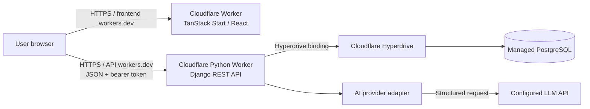

# System Architecture

**Status:** Proposed target architecture for the MVP  
**Current implementation:** Frontend prototype with browser-local mock storage  
**Contract:** [`../openapi.yaml`](../openapi.yaml)  
**Product requirements:** [`specs.md`](specs.md)

This document makes the stack and service boundaries concrete. It describes the target system; it does not claim that the backend, database, deployment, or AI integration already exist.

## 1. Architecture decisions

| Concern | Decision |
| --- | --- |
| Web application | Keep the existing React, TypeScript, TanStack Start frontend under `frontend/`, managed with Bun. Deploy it as a Cloudflare Worker using Cloudflare's Vite plugin and Wrangler. |
| Backend | Django with Django REST Framework, deployed as a Cloudflare Python Worker through its WSGI adapter. The backend owns authentication, validation, business rules, AI orchestration, and persistence. |
| API | JSON REST API under `/api`; `openapi.yaml` is the source of truth for paths, payloads, and responses. |
| Authentication | Username and password registration/login; return a signed bearer access token. Enforce ownership for every journal-data request. Production API CORS allows only explicitly configured HTTPS frontend origins through `django-cors-headers`, with credentials disabled. |
| Database | PostgreSQL in local Compose and a managed PostgreSQL provider in deployment. Connect the API Worker through Cloudflare Hyperdrive; use Django migrations for schema changes. |
| AI | A backend-only provider adapter. Ask for structured report output, validate it, and keep provider-specific calls out of views and frontend code. Use a deterministic fake provider in tests. |
| Local services | Docker Compose runs PostgreSQL and Django. Vite serves the frontend and proxies `/api` to Django during development. |
| Deployment | Publish separate frontend and API Workers. Deploy a tested commit to a development environment, smoke-test it, then promote the same revision to production. Use the free `workers.dev` hostnames initially. |

The bearer-token and endpoint choices follow the current OpenAPI contract. Cloudflare documents TanStack Start deployment on Workers and Django support through Python Workers. The Python package ecosystem is limited to compatible pure-Python, PyEmscripten, or Pyodide packages, so verify every backend dependency in a deployment proof of concept. Before implementation, resolve the specific token library and production AI provider; adding dependencies must follow the approval rule in the repository `AGENTS.md`.

References: [TanStack Start on Workers](https://developers.cloudflare.com/workers/framework-guides/web-apps/tanstack-start/), [Django on Python Workers](https://developers.cloudflare.com/workers/languages/python/packages/django/), [Python package support](https://developers.cloudflare.com/workers/languages/python/packages/), and [Hyperdrive with Python Workers](https://developers.cloudflare.com/hyperdrive/examples/python-workers/).

## 2. Runtime architecture



In development, Vite serves the frontend and Django serves `/api`; configure the Vite development proxy to forward `/api` to Django, so no CORS allowlist is needed locally. In the initial Cloudflare deployment, the frontend and API have separate `workers.dev` origins; set the exact HTTPS frontend origin in `CORS_ALLOWED_ORIGINS` and verify the preflight flow before release. CORS allows only the required API methods and `Authorization` / `Content-Type` headers, with cookie credentials disabled. The browser sends the bearer token required by `openapi.yaml`.

If a custom domain is added later, route both Workers under one site (`app.example.com` and `api.example.com`) or put a same-origin API proxy in front. Do not expose the PostgreSQL URL, Hyperdrive connection details, Django signing key, token signing key, or AI credentials in frontend variables.

The frontend currently disables SSR on data routes because its mock reads browser storage. After switching to the HTTP service, keep authenticated journal data client-side unless server rendering is deliberately redesigned to pass request-scoped credentials safely.

## 3. Component responsibilities

### Frontend (`frontend/`)

- Render the home, weekly reflection, feedback report, and history screens.
- Keep all backend operations behind the existing `GrowthService` interface in `src/services/api.ts`.
- Replace the current mock service with an HTTP implementation without making route components call `fetch` directly.
- Attach the bearer token to protected requests and handle expired/invalid sessions by returning the user to sign-in.
- Validate user input for usability; treat backend validation as authoritative.
- Never call the AI provider directly or store its secret in browser code.

The current mock service is a development prototype: it stores data in browser `localStorage`, and its report/question generation is heuristic code, not an LLM integration.

### Backend (`backend/`)

Organize Django code by domain, with a small number of apps:

- `accounts`: registration, login, token issuance, and current-user identity.
- `journal`: reviews, reports, commitments, data deletion, and API serializers/views.
- `feedback`: report-generation interface and provider adapter, called by the journal completion use case.

Keep HTTP views thin. A request should pass through authentication and serializer validation, call a domain service/use case, then serialize the result. Put transaction boundaries around completing a review and saving its report so a failed generation does not leave a completed review without the matching report.

For Cloudflare, expose the Django WSGI application through the `workers.wsgi` adapter and initialize/deploy it with `pywrangler`. Use a Hyperdrive binding to connect to managed PostgreSQL. The Python Worker compatibility date must meet Cloudflare's minimum for Hyperdrive; check the current Cloudflare guide when configuring it. Do not rely on local files for persistence: Python Worker files are ephemeral between isolates.

### AI provider adapter

Expose a small backend interface, for example `suggest_follow_ups(review, history)` and `generate_report(review, history)`. The production implementation calls the configured provider using server-side credentials. The test implementation returns deterministic structured data.

Validate the model response against the report schema before saving it. Each observation or hypothesis must include supporting text from the user's entries or relevant earlier reviews. Label interpretations as hypotheses, use cautious language, and allow the user to accept, reject, or correct them. Do not present psychological diagnoses or claims that are not supported by the supplied reflections. If generation or validation fails, return an actionable API error and leave the review editable.

## 4. Data model

All journal records belong to an authenticated user. Database foreign keys enforce ownership and cascading deletion. Use UUID primary keys for public resource identifiers and UTC timestamps for audit fields.

| Entity | Important fields and constraints |
| --- | --- |
| `User` | Django user identity; unique username; password stored using Django's password hashers. |
| `Review` | `user`, `week_start` (Monday date), five prompt answers, free writing, follow-ups, previous-action check, `status` (`draft` or `completed`), `created_at`, `updated_at`; unique constraint on (`user`, `week_start`). |
| `FeedbackReport` | One-to-one `review`, takeaways, strengths, challenges, patterns, proposed action, `generated_at`; store each insight's text, kind, evidence, status, and optional correction as structured JSON. |
| `Commitment` | One-to-one `review`, text, optional measure, `created_at`; the review's week identifies when the commitment was made and it applies to the following week. |

Store answers and report sections as JSON fields where the shape is already defined by the API contract. Keep user, review, report, and commitment relations explicit so ownership checks, uniqueness, and delete behavior are enforced by the database. Add indexes for a user's reviews ordered by `week_start` and for commitment lookup before a given week.

Deleting one review also deletes its report and commitment. Deleting all journal data removes all reviews, reports, and commitments for the authenticated user but preserves the account unless the user separately deletes it. Deleting an account cascades to all of that user's journal data.

## 5. API boundary

`openapi.yaml` defines the initial contract. Protected operations require `Authorization: Bearer <access-token>`. Registration and login are public. All reads, updates, and deletes are scoped to the authenticated user; an identifier belonging to another user must never expose or mutate that record.

The main resource operations are:

- `POST /api/auth/register` and `POST /api/auth/login`
- `GET /api/reviews`, `POST /api/reviews`, and `GET /api/reviews/by-week/{weekStart}`
- `GET`, `DELETE`, and completion/report operations under `/api/reviews/{reviewId}`
- Follow-up suggestions, insight updates, and commitment operations under the paths defined in `openapi.yaml`
- `GET /api/commitments/before?weekStart=...` for the prior action check-in
- `DELETE /api/data` to erase journal data for the authenticated user

Use the exact request and response schemas in the OpenAPI document. In particular, saving a review is an upsert by supplied review ID or by the unique user/week pair; completing a review generates or regenerates its report; and a commitment can be created or replaced for that review. Return consistent JSON errors with a `detail` field and appropriate `400`, `401`, `404`, and `409` statuses.

The OpenAPI contract currently returns `null` in a `200` response for absent single resources. Keep that behavior in the implementation or revise the contract and frontend together before changing it.

## 6. Request and data flow

1. The user saves a draft from the reflection screen. The frontend's HTTP `GrowthService` sends the review data to `POST /api/reviews`.
2. Django authenticates the user, validates the five answer fields and week date, and creates or updates that user's draft.
3. When the user completes the review, the frontend calls `POST /api/reviews/{reviewId}/complete`.
4. The backend loads the current review and relevant earlier completed reviews, calls the feedback service, validates the structured result, and saves the completed review and report in a transaction.
5. The user edits, accepts, or rejects an insight. The frontend sends only the changed status or correction to the insight `PATCH` endpoint; the backend verifies that the insight belongs to the user's report.
6. The user saves one commitment. The backend creates or updates the commitment for that review.
7. At the next review, the frontend requests the latest commitment whose `week_start` is earlier than the new review's week and asks the user what happened.

## 7. Configuration and environments

Keep secrets out of source control. Configure services through environment variables and provide a checked-in `.env.example` containing names and safe local defaults only.

| Variable | Used by | Purpose |
| --- | --- | --- |
| `DATABASE_URL` | Local backend | PostgreSQL connection string for Docker Compose development and tests. In Cloudflare, read the connection string from the Hyperdrive binding instead. |
| `APP_ENV` | Backend | Explicit environment mode: `development` locally and `production` for deployment checks. |
| `DJANGO_SECRET_KEY` | Backend | Django signing and cryptographic operations; unique per environment. |
| `DJANGO_DEBUG` | Backend | Enable debug behavior only in local development. |
| `DJANGO_ALLOWED_HOSTS` | Backend | Explicit host allowlist. |
| `CORS_ALLOWED_ORIGINS` | Backend | Comma-separated exact HTTPS frontend origins; required in production and blank for the local Vite proxy. |
| `TOKEN_SIGNING_KEY` | Backend | Signing key for access tokens; distinct by environment. |
| `AI_BASE_URL` | Backend | OpenAI-compatible API base URL for optional follow-up suggestions. |
| `AI_API_KEY` | Backend | Provider bearer credential; blank until configured and never exposed to the browser. |
| `AI_MODEL` | Backend | Model identifier accepted by the configured provider. |
| `AI_PROVIDER_MODE` | Backend | `fake` for deterministic local walkthroughs when `DJANGO_DEBUG=true`; `openai` for the optional configured provider. Fake mode is rejected when debug is false. |
| `VITE_API_BASE_URL` | Frontend | Local value is `http://localhost:8000/api`; production value is the API Worker origin plus `/api`, for example `https://weekly-growth-api.<account>.workers.dev/api`. This is public routing information, not a secret. |

Local Compose should start PostgreSQL with a health check, wait for it before starting Django, apply migrations, and expose the frontend and API on documented local ports. In Cloudflare, configure Hyperdrive separately for development and production and store application secrets using Worker secrets, not checked-in Wrangler variables. Production must use managed PostgreSQL backups. Debug mode, development credentials, and permissive CORS must not be enabled in production.

### Free-plan constraints

The initial deployment target is the Cloudflare Free plan and `workers.dev` URLs. Current published limits include 100,000 Worker requests per day and 10 ms of CPU time per invocation. Hyperdrive's Free plan includes 100,000 database queries per day. These limits can change; check them before deployment and monitor actual use. Django running through Pyodide may approach the CPU limit, so benchmark real API requests before relying on the free tier. The PostgreSQL provider is separate from Hyperdrive and may charge for database use, storage, or backups. The hosted AI provider may also charge per request. Cloudflare's [Workers limits](https://developers.cloudflare.com/workers/platform/limits/) and [Hyperdrive pricing](https://developers.cloudflare.com/hyperdrive/platform/pricing/) are the references for current quotas.

Cloudflare D1 is not the selected database for this design. The Django D1 backend documented by Cloudflare does not support transactions, while review completion and report persistence require an atomic operation. Hyperdrive preserves the PostgreSQL design and allows those transactions to remain in PostgreSQL.

## 8. Testing and delivery boundaries

- **Frontend unit tests:** exercise service behavior, date/week rules, report rendering, and form flows with an in-memory fake.
- **Backend unit tests:** cover validation, ownership rules, report orchestration, and commitment lookup using Django's test database and a fake AI provider.
- **API integration tests:** run against PostgreSQL and verify OpenAPI request/response behavior, authentication, per-user isolation, review completion, and deletion.
- **End-to-end tests:** run the app through Compose and cover registration/login, a weekly review, generated report, commitment, next-week follow-up, and data deletion.
- **CI:** lint and run frontend/backend unit tests, API integration tests, and build checks on each pull request. Validate both Worker builds before deployment.
- **Release:** deploy the frontend and API Workers to development, run health checks and a smoke test against the deployed PostgreSQL connection, then require deliberate promotion of the same commit to production.

The current repository has frontend tests only. These backend, integration, end-to-end, CI, and release steps are target work, not existing capabilities.

## 9. Privacy and operational safeguards

- Enforce authenticated ownership checks in the backend for every journal resource.
- Use HTTPS in deployment, password hashing, short-lived signed access tokens, and secret rotation. Avoid putting access tokens in local storage; prefer an HTTP-only, Secure, SameSite cookie if the selected auth design and OpenAPI contract are updated to support it. Otherwise, document and mitigate the token-storage risk before release.
- Do not log reflection bodies, AI prompts, provider responses, passwords, tokens, or API keys. Log request IDs, endpoint, status, duration, and safe error categories.
- Make data deletion cascade and test it. Backups must have a documented retention and deletion policy appropriate for personal reflections.
- Add health/readiness endpoints and monitor request failures, latency, database availability, and AI-provider errors. Alert on sustained failures and provide a runbook before production use.
- Treat AI output as untrusted input: validate its shape, render it as text, retain evidence, and allow the user to correct or reject interpretations.

## 10. Target repository layout

```text
README.md
AGENTS.md
openapi.yaml
docker-compose.yml
frontend/
  wrangler.jsonc
  vite.config.ts                 # Cloudflare Vite plugin for deployment
  src/services/api.ts          # frontend contract
  src/services/http/            # HTTP GrowthService implementation
  src/services/mock/            # local/test implementation until backend is connected
backend/
  manage.py
  pyproject.toml                # pywrangler / Workers-compatible package set
  wrangler.jsonc
  config/                       # settings, URLs, ASGI/WSGI
  accounts/
  journal/
  feedback/
  tests/
_docs/
  architecture.md
.github/workflows/
```

The first integration milestone is a deployment proof of concept: build the existing TanStack Start app with Cloudflare's supported Vite adapter, deploy a minimal Django endpoint as a Python Worker, and verify the chosen PostgreSQL driver through Hyperdrive. Measure Worker CPU time and confirm every dependency is compatible before moving the journal API. Then implement authentication and review CRUD, connect the frontend's HTTP `GrowthService`, and persist reviews in PostgreSQL. Add report generation and commitments after that boundary works end to end.
